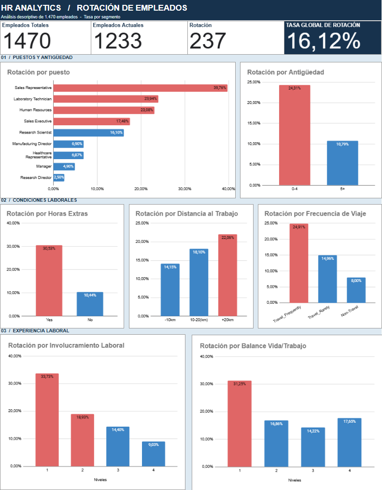

# 📊 Análisis de Rotación de Empleados | HR Analytics

Proyecto de análisis de datos sobre la rotación de empleados, desarrollado en **Google Sheets**.

---

## 🎯 Objetivo

El objetivo es identificar patrones asociados con la salida de empleados de una empresa, analizar posibles factores relacionados con la rotación y presentar hallazgos que puedan contribuir a la toma de decisiones en Recursos Humanos.

Analizar una base de datos de **1.470 empleados** para responder preguntas como:

- ¿Qué puestos presentan mayores tasas de rotación?
- ¿Cómo se relacionan la antigüedad y las horas extras con la rotación?
- ¿Qué diferencias existen según las condiciones laborales y el involucramiento de los empleados?

## 🛠️ Herramientas utilizadas

| Herramienta | Uso |
|---|---|
| Google Sheets | Limpieza, organización y análisis de datos |
| Reportes Tabulares | Cálculo de KPIs y tasas de rotación |
| Tablas Dinámicas | Agrupación y segmentación de empleados |
| Gráficos | Visualización de resultados y construcción del dashboard |

## 📈 Dashboard

Se desarrolló un dashboard con los principales indicadores y comparaciones de rotación según puesto, antigüedad, horas extras, distancia al trabajo, frecuencia de viajes, involucramiento laboral y equilibrio entre vida personal y trabajo.

**[🔗 Explorar el análisis completo en Google Sheets](https://docs.google.com/spreadsheets/d/1eHrzcty6iNpjkyJuEfS8rt61GoiMY9Hd6Tty-9mmNLg/edit?usp=sharing)**

---

## 🔎 Hallazgos principales

La base analizada presenta una **tasa global de rotación del 16,12%**, equivalente a 237 empleados que abandonaron la empresa.

- **Antigüedad y rotación:** Los empleados con hasta 4 años de antigüedad presentan una tasa de rotación del **24,3%** (141 de 580), frente al **10,8%** (96 de 890) de quienes tienen 5 años o más. La diferencia es de **13,5** puntos porcentuales, lo que identifica a los empleados de menor antigüedad como un segmento prioritario para tomar las iniciativas de retención.
- **Horas extras y rotación:** Los empleados que realizan horas extras presentan una tasa de rotación del **30,5%** (127 de 416), frente al **10,4%** (110 de 1.054) de quienes no las realizan. Esta diferencia de **20,1** puntos porcentuales indica una asociación importante entre las horas extras y la rotación, por lo que resulta relevante evaluar la carga laboral y sus posibles efectos en la retención.
- **Viajes laborales y rotación:** Los empleados que viajan frecuentemente presentan una tasa de rotación del **24,9%**, frente al **15,0%** de quienes viajan ocasionalmente y al **8,0%** de quienes no realizan viajes laborales. La diferencia de **16,9** puntos porcentuales entre los extremos sugiere que la frecuencia de viajes es una variable relevante para analizar la rotación.
- **Distancia entre el hogar y el trabajo:** Los empleados que viven a más de 20 km del trabajo presentan una tasa de rotación del **22,1%** (45 de 204), frente al **14,1%** (133 de 940) de quienes viven a 10 km o menos. La diferencia de 8 puntos porcentuales sugiere que la distancia al trabajo podría influir en la retención, por lo que sería conveniente evaluar alternativas de trabajo híbrido y flexibilidad horaria.
- **Puesto de trabajo y rotación:** Los representantes de ventas registran la tasa de rotación más elevada, con un **39,8%** (33 de 83), seguidos por los técnicos de laboratorio, con un **23,9%** (62 de 259), y los empleados de Recursos Humanos, con un **23,1%** (12 de 52). Los resultados permiten identificar puestos prioritarios para investigar las condiciones laborales y desarrollar estrategias de retención específicas.
- **quilibrio entre vida personal y trabajo:** Los empleados con el nivel más bajo de equilibrio entre vida personal y trabajo presentan una tasa de rotación del **31,3%** (25 de 80), frente al **14,2%** (127 de 893) de quienes tienen un nivel 3. La diferencia de **17,1** puntos porcentuales señala al grupo con peor equilibrio como un segmento de riesgo, aunque la relación no es completamente lineal entre los cuatro niveles.
- **Satisfacción e involucramiento laboral:** Los empleados con el nivel más bajo de involucramiento laboral presentan una tasa de rotación del **33,7%**, frente al **9,0%** de quienes registran el nivel más alto. Esta diferencia de **24,7** puntos porcentuales evidencia una asociación importante entre el involucramiento y la permanencia, por lo que mejorar la experiencia laboral podría ser una prioridad para Recursos Humanos.

**Nota:** Este es un análisis descriptivo. Los resultados muestran asociaciones entre variables, pero no permiten establecer relaciones de causalidad.

---

## 👤 Autor

**Augusto Valles · JackyDye**

[GitHub](https://github.com/JackyDye) · [LinkedIn](https://www.linkedin.com/in/augusto-valles/)

*Proyecto desarrollado como parte de mi formación en Data Analytics.*